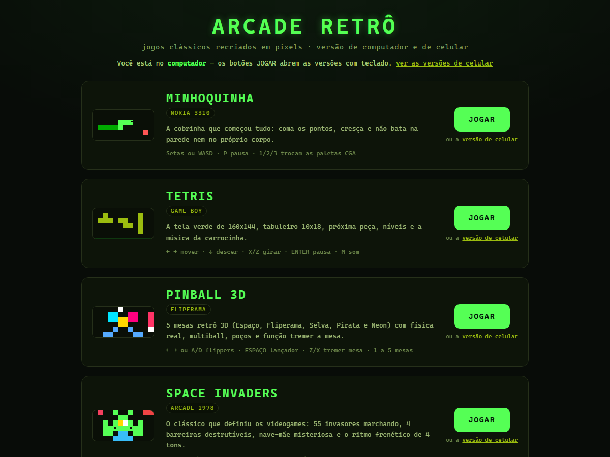

# 🕹️ Retro Arcade Web Collection

An authentic, zero-dependency browser collection of 4 classic retro arcade games with a CRT aesthetic, custom physics engines, Web Audio API sound synthesis, dual responsive layouts (Desktop CRT Cabinet & Fullscreen Touch Mobile), and automatic platform routing.



---

## 🎮 The Games

### 1. Snake (Minhoquinha)
* **Classic Grid Snake Action**: Smooth speed scaling, boundary-aware navigation, and food generation.
* **Desktop**: Keyboard arrows / WASD with retro green phosphor CRT glow.
* **Mobile**: Fullscreen layout with an ergonomic virtual directional pad (D-Pad).

| Desktop Cabinet | Mobile Fullscreen |
| :---: | :---: |
|  |  |

---

### 2. Tetris
* **Authentic 1989 Rules**: 7 tetrominoes, standard SRS wall-kick rotations, ghost piece projection, hold piece slot, next queue, progressive gravity drop, and line-clear combo scoring.
* **Shared Engine**: Both desktop and mobile run from a unified engine (`tetris.js`).
* **Desktop**: Side telemetry, high scores, level tracking, and customizable audio.
* **Mobile**: Responsive touch buttons for left, right, soft drop, hard drop, rotate, and hold.

| Desktop Cabinet | Mobile Fullscreen |
| :---: | :---: |
|  |  |

---

### 3. Pinball 3D
* **Custom 2D/3D Physics Engine**: High-frequency sub-step Verlet integration with anti-stick sloped surfaces, continuous flipper restitution, and non-blocking trajectory paths.
* **5 Dynamic Interactive Themes**:
  1. *Deep Space Orbit*
  2. *Retro Neon Arcade*
  3. *Jungle Adventure*
  4. *Pirate Treasure*
  5. *Cyberpunk 1984*
* **Real Features**: Multi-bumpers, kinetic slingshots, drop targets, spinners, plunger with variable pull-and-release tension, table nudge/shake button (with tilt penalty), and realistic flipper cradle mechanics.

| Desktop Cabinet | Mobile Fullscreen |
| :---: | :---: |
|  |  |

---

### 4. Space Invaders
* **Faithful 1978 Arcade Recreation**: Full fleet of 55 aliens across 5 rows (Squids, Crabs, and Octopuses) marching down in unison with a classic 2-frame sprite animation.
* **Features**:
  * 4 destructible defense bunkers made of dynamic pixel blocks.
  * Mystery Flying Saucer (UFO) with warble siren and bonus scores (50 to 300 pts).
  * 4-tone descending bassline audio synthesizer that accelerates exponentially as aliens are eliminated.
  * Native 480x640 rendering with retro phosphor scanlines.

| Desktop Cabinet | Mobile Fullscreen |
| :---: | :---: |
|  |  |

---

## 🚀 Key Features

* **Zero External Dependencies**: Pure vanilla HTML5, CSS3, JavaScript, HTML5 Canvas, and Web Audio API. No frameworks, build tools, or bundlers required.
* **Smart Device Routing**: Handled seamlessly by `roteador.js`. Opening the game on a phone loads the mobile touch interface; opening on a PC loads the desktop cabinet view with sidebar telemetry.
* **Manual Platform Override**: Append `?desktop=1` or `?mobile=1` to any game URL to force a specific interface mode.
* **PWA & Touch-Ready**: Optimized multi-touch pointer event handling with low latency and zero double-tap zoom delay (`touch-action: manipulation`).
* **Web Audio API**: Real-time sound synthesis for retro beeps, laser zaps, bumper bounces, and alien march tones without requiring external audio asset files.

---

## 📂 Repository Structure

```
.
├── index.html                    # Main menu & game selector
├── roteador.js                   # Client-side platform detector & router
├── minhoquinha-desktop.html      # Snake (Desktop cabinet)
├── minhoquinha-mobile.html       # Snake (Mobile touch)
├── tetris.js                     # Tetris game engine
├── tetris-desktop.html           # Tetris (Desktop cabinet)
├── tetris-mobile.html            # Tetris (Mobile touch)
├── pinball.js                    # Pinball 3D custom physics engine
├── pinball-desktop.html          # Pinball (Desktop cabinet)
├── pinball-mobile.html           # Pinball (Mobile touch)
├── space-invaders.js             # Space Invaders arcade engine
├── space-invaders-desktop.html   # Space Invaders (Desktop cabinet)
├── space-invaders-mobile.html    # Space Invaders (Mobile touch)
├── tela-*.png                    # Game screenshots and banners
├── .gitignore                    # Git ignore file
└── README.md                     # Project documentation
```

---

## 🌐 Running Locally

No installation or build steps are necessary:

1. Clone or download this repository:
   ```bash
   git clone https://github.com/<your-username>/<repo-name>.git
   cd <repo-name>
   ```
2. Open `index.html` directly in any modern browser:
   * **Windows**: Double-click `index.html` or run `start index.html`
   * **Mac**: `open index.html`
   * **Linux**: `xdg-open index.html`

Or serve it with a local HTTP server:
```bash
# Using Python 3
python -m http.server 8080

# Using Node.js (npx)
npx serve .
```

---

## ☁️ Deploying to GitHub Pages

You can host this entire collection online for free using GitHub Pages:

1. Push this repository to GitHub.
2. Go to your repository on GitHub and open **Settings** > **Pages**.
3. Under **Branch**, select `main` and root directory `/(root)`.
4. Click **Save**.
5. Your arcade collection will be live at:
   `https://<your-username>.github.io/<repo-name>/`

---

## 📜 License

This project is licensed under the MIT License - feel free to use, modify, and distribute!
