# 🕹️ Retro Arcade Web Collection v3.0

[](https://github.com/marceloasl99/arcade-retro-web)
[](https://github.com/marceloasl99/arcade-retro-web)
[](https://github.com/marceloasl99/arcade-retro-web)
[](https://github.com/marceloasl99/arcade-retro-web)
[](LICENSE)

An authentic, zero-dependency browser collection of **12 classic retro arcade games** with authentic CRT cabinet aesthetics, custom physics engines, procedural Web Audio API sound synthesis, dual responsive layouts (Desktop CRT Cabinet with sidebar telemetry & Fullscreen Touch Mobile), automatic platform routing, and full bilingual support (English by default with instant Portuguese toggle).

Designed to fit **all 12 games simultaneously on a standard Full HD monitor (1920×1080) with zero vertical scroll**.

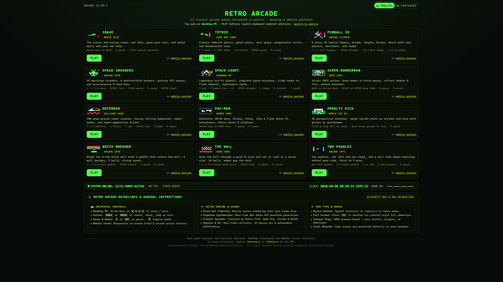

---

## 🌟 What's New in Version 3.0

* **Three New Games**:
  * **Brick Breaker (Quebra-Tijolos, 1976)**: Breakout-style wall of 6 rows of bricks, 4 wall designs that repeat, 3 balls and speed that rises as bricks fall.
  * **The Wall (Game Show Pin Board)**: drop the ball through a grid of pins and watch it land in one of 9 prize slots; 10 balls per game.
  * **Two Paddles (Dois Traços, 1972)**: a Pong-style duel with a paddle on each side. Play 2 players on the same keyboard or against the CPU; first to 7 wins.
* **Hub with 12 Games**: the menu grid is now 3 columns × 4 rows and still fits a 1080p screen with no scroll. The three new games have their own icons, cards and PLAY buttons.
* **Arenas Fill the Window**: the playing field of the three new games now uses all the available area of the window (desktop center panel and the full phone screen), instead of a letterboxed 480×640 box.
* **The Wall Pin Fix**: the pin grid was redesigned so the ball can no longer fall straight down the sides and land in the 1000-point slots.
* **Two Paddles Score Layout**: the score and labels are centered on the real width of the court.
* **New Screenshots**: refreshed hub screenshot and desktop/mobile captures for every new game.
* **Tests**: a self-test suite for each new game (`_selftest_brick_breaker.js`, `_selftest_the_wall.js`, `_selftest_dois_tracos.js`), and the router test accepts the `?v=2.2` cache-busting parameter.

---

## 🌟 What's New in Version 2.2

* **Mobile Responsive Overhaul & Zero-Sway Navigation**:
  * Fixed horizontal swaying and displacement on smartphone browsers (`index.html` enforced with strict `max-width: 100vw; overflow-x: hidden;`).
  * Responsive header and telemetry bars with auto-wrapping, flexible cards, and break-word protection for long IPv6 addresses.
* **Chrome Mobile Dynamic Viewport (`--app-height`)**:
  * Solved the mobile Chrome address bar and navigation bar clipping issue using live `window.visualViewport.height` measurement.
  * Virtual controls, touch decks, and game canvases now dynamically adapt to available height, guaranteeing zero control cut-offs.
* **Universal Fullscreen Toggle (`⛶ FULL` / `🗗 EXIT`) on All 9 Mobile Games**:
  * Added a prominent, retro-styled Fullscreen toggle button to the top header across all 9 mobile editions:
    * **`⛶ FULL`** (English) / **`⛶ CHEIA`** (Portuguese) in normal mode.
    * **`🗗 EXIT`** (English) / **`🗗 SAIR`** (Portuguese) when fullscreen is engaged.
  * Cross-browser support (`requestFullscreen` / `exitFullscreen` with webkit, moz, and ms fallbacks).
* **Ergonomic Touch Deck Scaling**:
  * D-pads and action buttons converted to proportional height limits (`min(140px, 20vh)` / `clamp()`) to remain 100% accessible on portrait devices such as Samsung Galaxy S23+.

---

## 🌟 What's New in Version 2.1

* **Game Boy DMG Authentic Tetris Overhaul**:
  * Exact 160×144 resolution and 10:9 aspect ratio matching the 1989 Nintendo Game Boy DMG hardware.
  * Flanking procedural brick walls (left `x=0..7` and dividing right wall `x=88..95`) with authentic mortar lines and DMG 4-shade green palette.
  * Classic double-bordered rounded HUD boxes: `SCORE` (with double divider lines), `LEVEL`, `LINES`, and centered `NEXT` piece preview.
  * Authentic tetromino textures: Greek key swirl (`T`), concentric window squares (`I`/`O`), beveled frames (`L`/`J`), and stippled dots (`S`/`Z`).
* **Pac-Man Arcade Grid & Stage Progression Fixes**:
  * Completely eliminated dead/unused grid borders with a precision 28-column × 30-row authentic maze layout.
  * Seamless lateral tunnel wrap at rows 14–15 without clipping or obstruction.
  * 10 distinct level progression stages with progressive speed curves and authentic bonus fruit icons: 🍒 Cherry (100 pts), 🍓 Strawberry (300 pts), 🍊 Orange (500 pts), 🍎 Apple (700 pts), 🍈 Melon (1000 pts), 🚀 Galaxian Flagship (2000 pts), 🔔 Bell (3000 pts), and 🗝️ Master Key (5000 pts).
  * Authentic *Cruise Elroy* acceleration for Blinky as dots are consumed.
* **Mobile Touch Enhancements**:
  * Crisp integer-scaled rendering preserving exact pixel art ratios across all modern smartphones.
  * Polished D-pad directional navigation on mobile.

---

## 🌐 Bilingual Support (English & Portuguese)

* **English by Default (`en`)**: All games, menus, instructions, and HUD telemetry are rendered in English by default.
* **Instant Portuguese Toggle (`pt`)**: Toggle with one click anytime using the `🇺🇸 EN · PT` / `🇧🇷 PT · EN` button in the header of any page without losing your game progress.
* **Persistent & Shareable**: Saves your preferred language to `localStorage` or forces a specific language using URL query parameters:
  * `index.html?lang=en` ➡️ Loads in English
  * `index.html?lang=pt` ➡️ Loads in Portuguese

---

## 📺 Full HD Zero-Scroll 3×4 Menu

* On standard 1080p desktop monitors (1920×1080), the 12 games are laid out in a compact, highly legible **3-column × 4-row grid**.
* **Zero vertical scrolling required**: All game covers, badges, descriptions, controls, and play buttons are immediately visible on screen upon loading.

---

## 🎮 The 12 Arcade Games

### 1. Snake (Minhoquinha)
* **Classic Grid Snake Action**: Smooth speed scaling, boundary-aware navigation, and food generation.
* **Desktop**: Keyboard arrows / WASD with retro green phosphor CRT glow.
* **Mobile**: Fullscreen layout with an ergonomic virtual directional pad (D-Pad).

| Desktop Cabinet | Mobile Fullscreen |
| :---: | :---: |
| 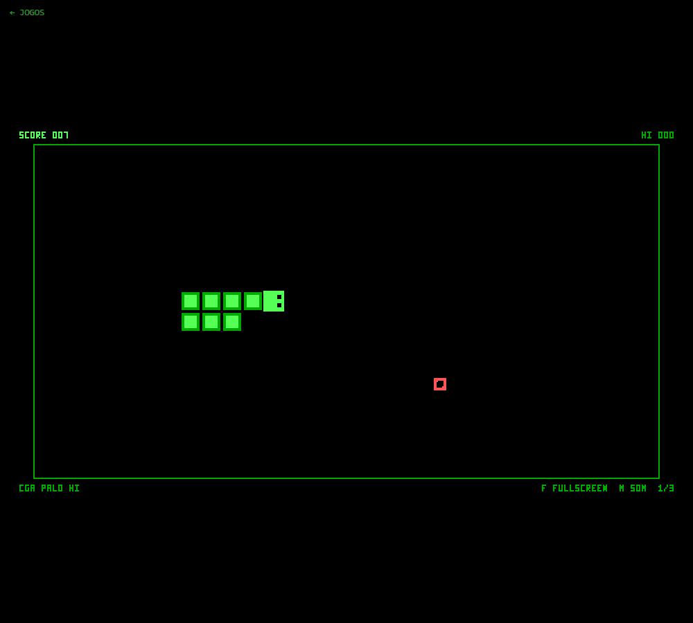 | 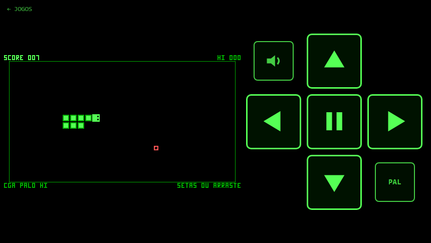 |

---

### 2. Tetris
* **Authentic 1989 Game Boy DMG Recreation**: Exact 160×144 LCD resolution, 10×18 well flanked by left and right procedural brick walls with authentic mortar lines.
* **Classic DMG Interface**: Double-bordered rounded HUD compartments for `SCORE` (with horizontal dividers), `LEVEL`, `LINES`, and centered `NEXT` piece preview box.
* **Piece Textures & Rules**: 4 authentic DMG piece textures (Greek key swirl for `T`, concentric squares for `I`/`O`, bevel for `L`/`J`, stipple dots for `S`/`Z`), authentic gravity drop curve, and classic Game Boy rotation (without modern wall kicks).
* **Shared Engine**: Both desktop and mobile run from a unified engine (`tetris.js`) with instant DMG and Pocket palette switching and chiptune sound synthesis.

| Desktop Cabinet | Mobile Fullscreen |
| :---: | :---: |
| 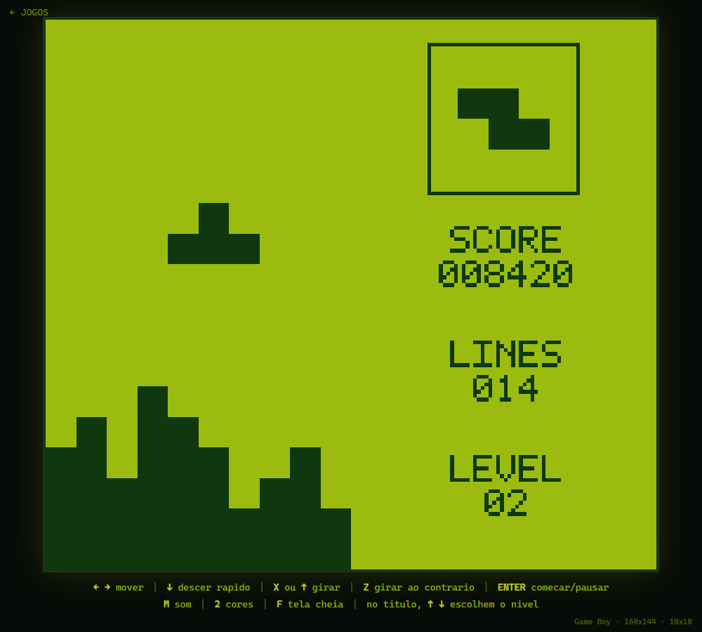 | 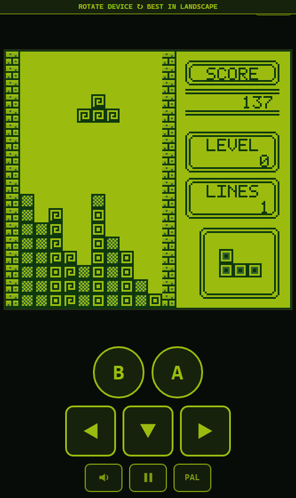 |

---

### 3. Pinball 3D
* **Custom 2D/3D Physics Engine**: High-frequency sub-step Verlet integration with anti-stick sloped surfaces, continuous flipper restitution, and non-blocking trajectory paths.
* **5 Dynamic Interactive Themes**:
  1. *Deep Space Orbit*
  2. *Retro Neon Arcade*
  3. *Jungle Adventure*
  4. *Pirate Treasure*
  5. *Cyberpunk 1984*
* **Real Features**: Multi-bumpers, kinetic slingshots, drop targets, spinners, plunger with variable pull-and-release tension, table nudge/shake button (with tilt penalty), and realistic flipper cradle mechanics.

| Desktop Cabinet | Mobile Fullscreen |
| :---: | :---: |
| 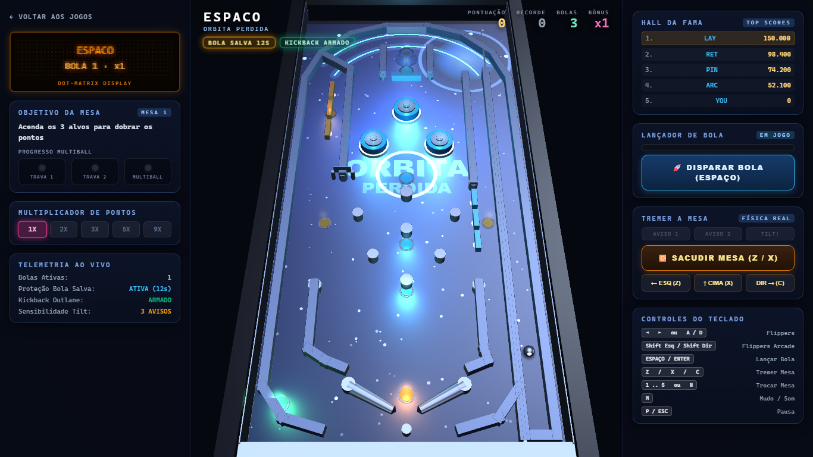 | 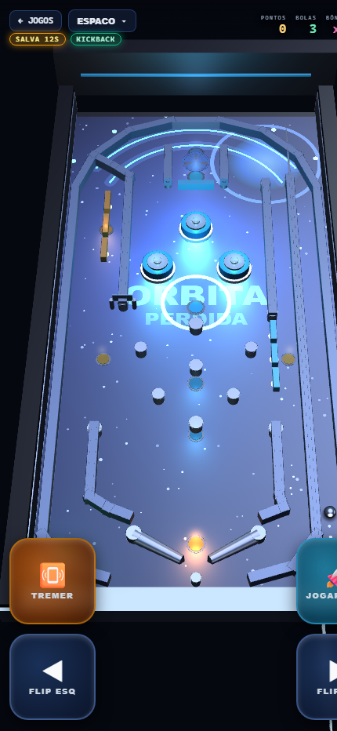 |

---

### 4. Space Invaders
* **Faithful 1978 Arcade Recreation**: Full fleet of 55 aliens across 5 rows (Squids, Crabs, and Octopuses) marching down in unison with classic 2-frame sprite animation.
* **Features**:
  * 4 destructible defense bunkers made of dynamic pixel blocks.
  * Mystery Flying Saucer (UFO) with warble siren and bonus scores (50 to 300 pts).
  * 4-tone descending bassline audio synthesizer that accelerates exponentially as aliens are eliminated.
  * Native rendering with retro phosphor scanlines.

| Desktop Cabinet | Mobile Fullscreen |
| :---: | :---: |
| 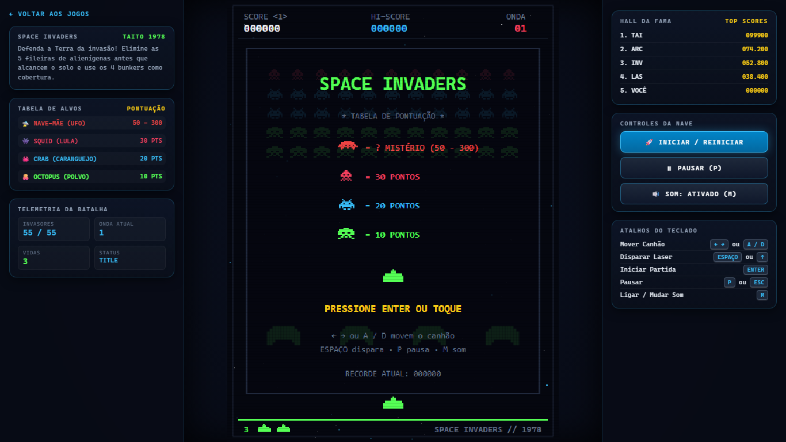 | 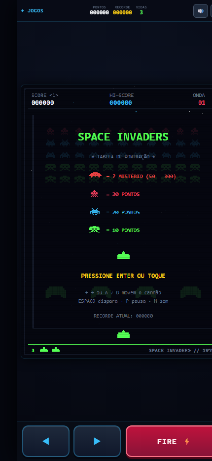 |

---

### 5. Space Cadet (3D Pinball Windows 1995)
* **The Legendary Windows 95 Pinball**: 100% authentic physics, sound effects, and mission mechanics powered directly by native decompiled C++ WebAssembly (`3DPinballSpaceCadet.js`).
* **Enhanced Visuals**: High-contrast CRT arcade cabinet, proportional aspect ratio scaling, glass reflection overlays, and reactive cabinet glow.
* **Missions & Rank Progression**:
  * Complete 9 space missions to climb the ranks: *Cadet* ➡️ *Ensign* ➡️ *Lieutenant* ➡️ *Commander* ➡️ *Captain* ➡️ *Fleet Admiral*.
  * Interactive table features: Launch Ramp skill shots, Attack Bumpers, Hyperspace Chute, Wormhole, Drop Targets, and Outlane Kickback ball saver.

| Desktop Cabinet | Mobile Fullscreen |
| :---: | :---: |
| 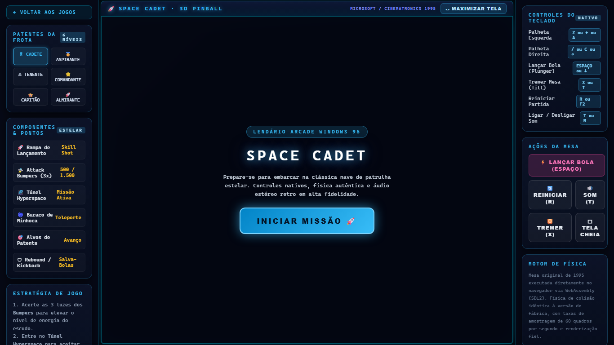 | 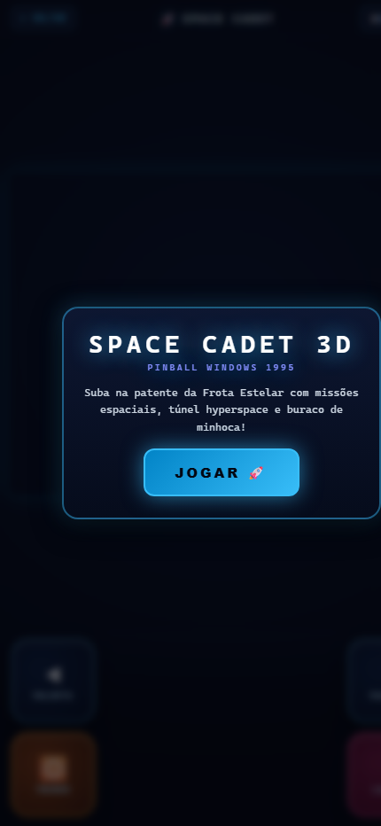 |

---

### 6. Super Bomberman (SNES 1993)
* **16-Bit Super Nintendo Aesthetic**: Rich checkerboard grass arena, 3D stone pillars with bevel highlights and shadows, destructible brick walls, and vibrant multi-directional fire crosses.
* **Smooth Controls with Corner Assist**: Gently slides the character around pillar corners when turning, preventing corridor edge snags.
* **Power-up Drops**:
  * 💣 **Bomb Up**: Increases simultaneous active bombs.
  * 🔥 **Fire Up**: Increases flame explosion blast radius.
  * 👟 **Speed Skate**: Increases character walking speed.
  * ❤️ **Shield Heart**: Absorbs one hit/blast without losing a life.
  * 🚪 **Exit Portal**: Opens once all patrolling enemies are defeated to advance to the next stage.
* **Enemy Bestiary**: Ballom (orange balloon, 100 pts), Onil (blue droplet, 200 pts), Dahl (spinning star, 400 pts), and Minvo (agile hunter, 800 pts).

| Desktop Cabinet | Mobile Fullscreen |
| :---: | :---: |
| 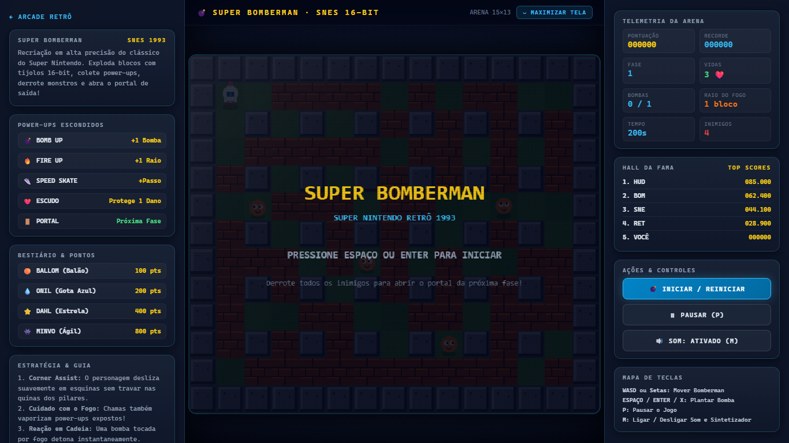 | 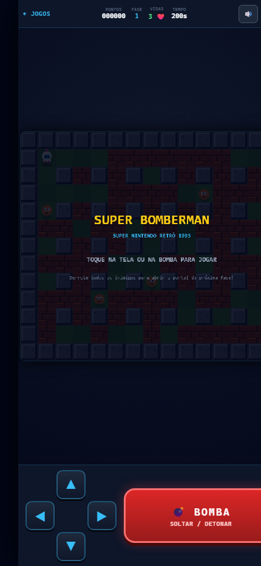 |

---

### 7. Defender (Williams 1980)
* **Planetary Defense Force**: 4,800px horizontal wrap-around world with procedural mountain terrain.
* **360° Long-Range Radar Scanner**: Overhead telemetry tracking all aliens and humanoids across the planet in real-time.
* **Full Alien Fleet**:
  * *Landers*: Abduct humanoids from the planet surface.
  * *Mutants*: Hyper-aggressive pursuers triggered if a Lander reaches the sky with a human.
  * *Bombers*: Drop stationary floating space mines.
  * *Pods & Swarmers*: Exploding pods that burst into swarms of hyper-fast interceptors.
  * *Baiters*: High-speed hunter-killer ships appearing when waves take too long.
* **Rescue System**: Shoot abducting Landers, catch falling humanoids in mid-air, and set them down safely for 1,000 bonus points.
* **Emergency Systems**: Screen-clearing Smart Bombs (EMP) and Hyperspace jumps.

| Desktop Cabinet | Mobile Fullscreen |
| :---: | :---: |
| 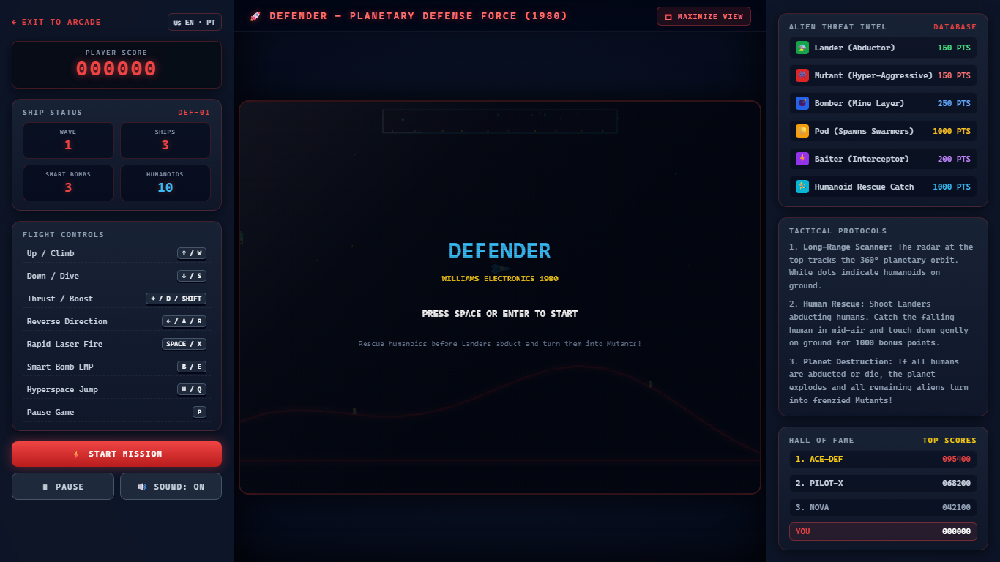 | 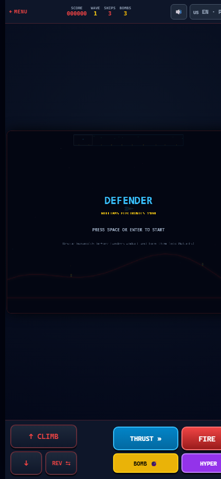 |

---

### 8. Pac-Man (Namco 1980)
* **Authentic Arcade Maze**: Complete 28×36 grid with wrap-around side tunnels.
* **4 Unique Ghost AI Personalities**:
  * 🔴 **Blinky (Shadow)**: Direct relentless chaser targeting Pac-Man's exact coordinates.
  * 🌸 **Pinky (Speedy)**: Strategic ambusher targeting 4 tiles ahead of Pac-Man.
  * 🔷 **Inky (Bashful)**: Complex dual-vector targeting calculated from Blinky and Pac-Man.
  * 🟠 **Clyde (Pokey)**: Chases when far (>8 tiles), retreats to scatter corner when close.
* **Game Phases**:
  * Scatter / Chase timed cycles.
  * Frightened mode with flashing blue/white ghosts and combo score multipliers (200 ➡️ 400 ➡️ 800 ➡️ 1,600 pts).
  * Cherry & Fruit bonus pickups.
  * Chiptune audio synthesizer generating waka-waka, siren hums, fruit eating, and classic death jingles.

| Desktop Cabinet | Mobile Fullscreen |
| :---: | :---: |
| 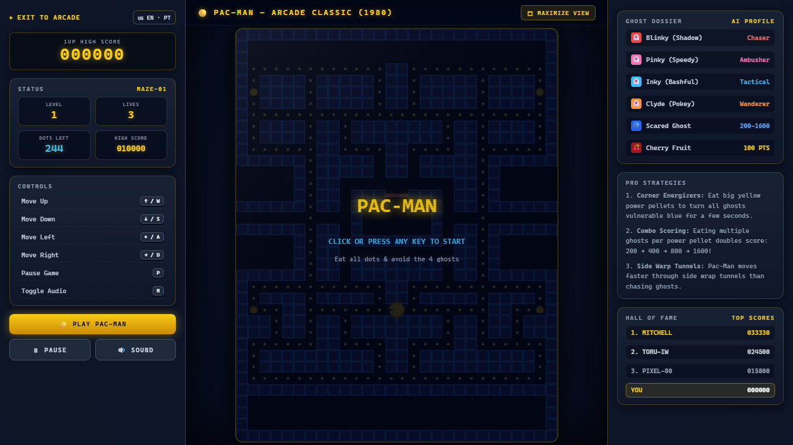 | 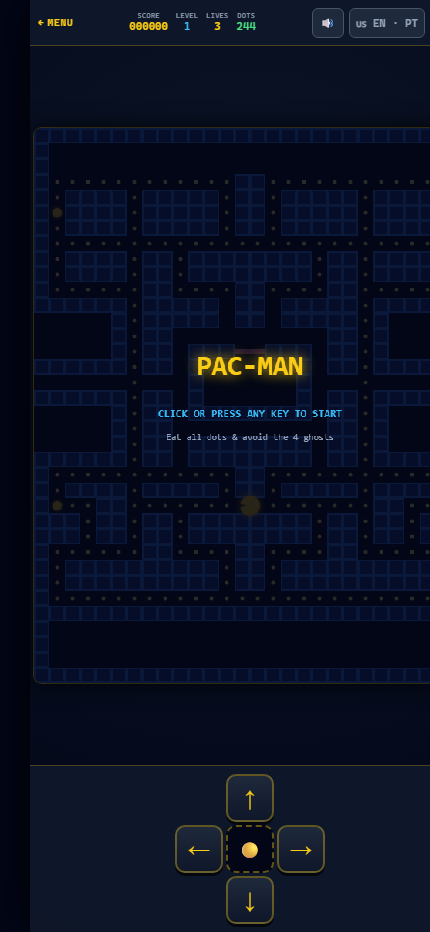 |

---

### 9. Penalty Kick Online (3D World Cup Shootout)
* **Authentic 3D Shootout Simulation**: High-fidelity 1280×640 (2:1 aspect ratio) widescreen stadium pitch.
* **Authentic Assets & Graphics**:
  * Official stadium pitch & crowd background.
  * 3D goal posts with pixel-perfect perspective geometry.
  * Realistic 7-frame rotating soccer ball with Magnus effect curl, elevation arc, and dynamic pitch shadow.
  * Goalkeeper with true 3D jumping parabolic arcs, dive postures, and grounded pitch shadow.
  * Ergonomic interactive goalkeeper gloves (single pair of hands that snap together on saves).
  * Sharp opponent kicker sprite frame.
* **Alternating Tournament Roles**:
  * ⚽ **Striker Mode**: Drag / swipe trajectory from penalty spot or click directly on the goal to place precision shots into the corners.
  * 🧤 **Goalkeeper Mode**: Take control of goalkeeper gloves via mouse or touch to dive and deflect CPU striker shots.
* **Tournament Shootout Rules**:
  * Best-of-5 tournament shootout with sudden-death tiebreakers.
  * Authentic audio FX: Ball kick thuds, net rustle, glove saves, post/crossbar clangs, whistle blasts, and crowd celebrations.

| Desktop Cabinet | Mobile Fullscreen |
| :---: | :---: |
| 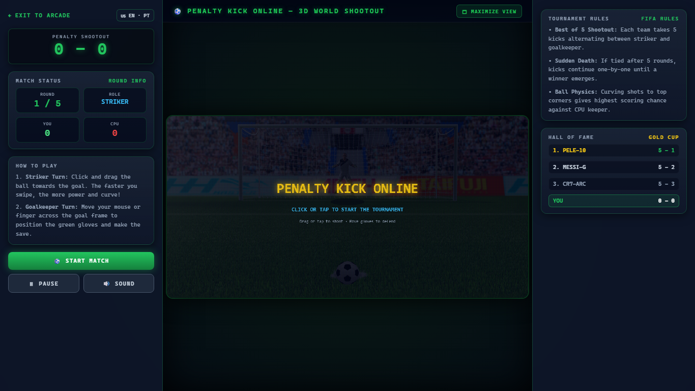 | 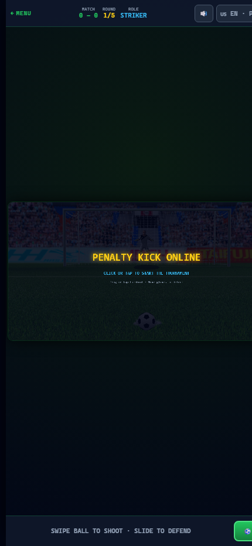 |

---

### 10. Brick Breaker (Quebra-Tijolos, Arcade 1976)
* **Classic Breakout Wall**: 8×6 brick wall, with the top rows worth the most (70 to 20 pts).
* **4 Wall Designs**: full wall, checkerboard, diamond and fortress, repeating after the last one.
* **Angle Control**: hitting the edge of the paddle sends the ball off sharply; speed rises as bricks fall.
* **Desktop**: arrows / A-D or mouse · **Mobile**: ◀ ▶ buttons, LAUNCH button, drag on the arena.

| Desktop Cabinet | Mobile Fullscreen |
| :---: | :---: |
| 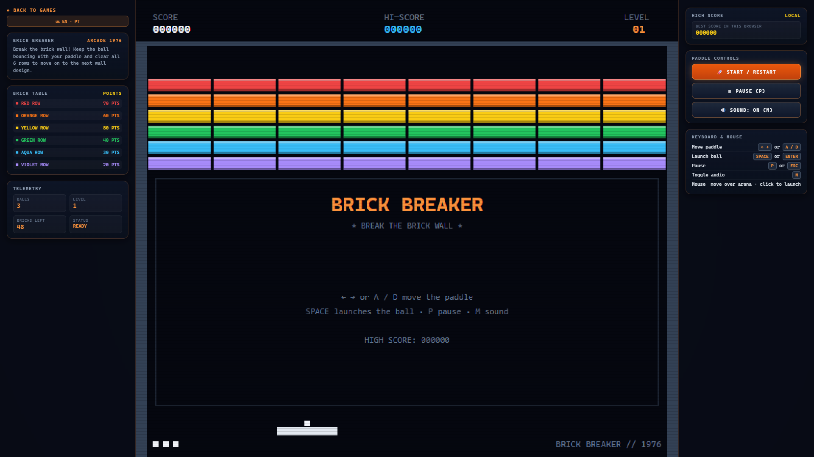 | 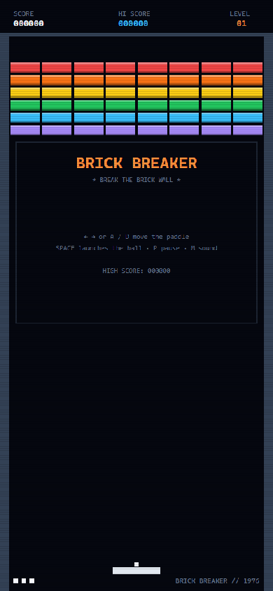 |

---

### 11. The Wall (Game Show Pin Board)
* **Drop Board**: pick where to drop the ball, then watch it bounce through a grid of pins.
* **9 Prize Slots**: edges pay 1000, the center pays 50; the dividers stop the ball from rolling between slots.
* **10 Balls per Game** and a high score saved in the browser.
* **Desktop**: arrows / A-D or mouse · **Mobile**: ◀ ▶ buttons, DROP button, drag to aim.

| Desktop Cabinet | Mobile Fullscreen |
| :---: | :---: |
| 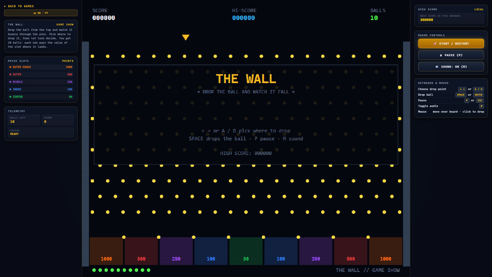 | 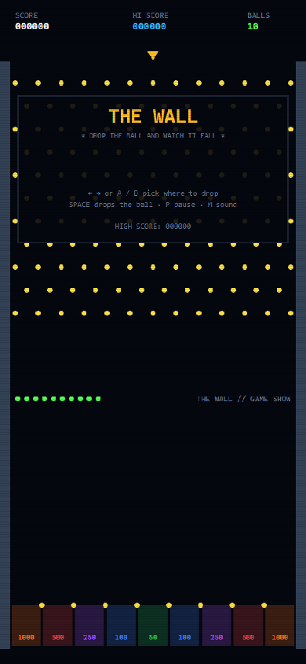 |

---

### 12. Two Paddles (Dois Traços, Arcade 1972)
* **Pong-style Duel**: one paddle on the left, one on the right, and a ball that keeps bouncing between them.
* **2 Players or vs CPU**: both players share one keyboard (W/S and ↑/↓); press 1 for the CPU or 2 for two players.
* **First to 7 Wins**, with the longest rally saved in the browser.
* **Desktop**: W/S and ↑/↓ · **Mobile**: 4 touch arrows (two per side) and a 1P/2P toggle.

| Desktop Cabinet | Mobile Fullscreen |
| :---: | :---: |
| 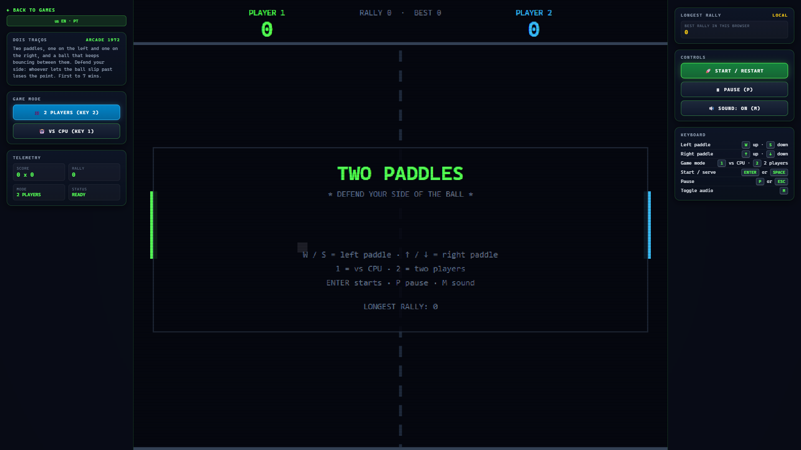 | 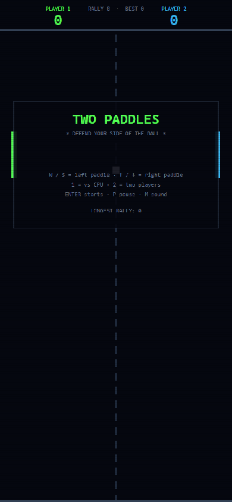 |

---

## 🕹️ Controls Quick Reference

| Game | Desktop (Keyboard / Mouse) | Mobile (Touch / On-Screen) |
| :--- | :--- | :--- |
| **Snake** | Arrow Keys / WASD | Ergonomic 4-way D-Pad |
| **Tetris** | Left/Right, Down (Soft), Up (Rotate), Space (Hard), C (Hold) | On-screen control pad & action buttons |
| **Pinball 3D** | Left/Right Shift / A/D (Flippers), Space (Plunger), N (Nudge) | Touch sides for flippers, pull-down plunger |
| **Space Invaders** | Left/Right Arrows / A/D (Move), Space / Up (Shoot) | Touch left/right zones, dedicated fire button |
| **Space Cadet** | Z / / (Flippers), Space (Plunger), X / . (Nudge) | Side tap triggers, launch button |
| **Bomberman** | Arrows / WASD (Move), Space / Enter (Plant Bomb) | Virtual joystick / D-pad, Bomb action button |
| **Defender** | Arrows / WASD (Thrust/Pitch), Space (Fire), B (Smart Bomb), H (Hyperspace) | Virtual flight stick, fire & bomb triggers |
| **Pac-Man** | Arrow Keys / WASD | Swipe gestures & virtual directional buttons |
| **Penalty Kick** | Click & Drag / Click to Shoot · Move Mouse (Gloves) | Swipe ball / Tap goal · Touch & drag gloves |
| **Brick Breaker** | Left/Right or A/D / Mouse move · SPACE/ENTER launch · P/ESC pause | ◀ ▶ buttons · LAUNCH button · drag arena |
| **The Wall** | Left/Right or A/D choose drop point · SPACE/ENTER drop · P/ESC pause | ◀ ▶ buttons · DROP button · drag to aim |
| **Two Paddles** | W/S left paddle · ↑/↓ right paddle · 1 vs CPU · 2 two players | 4 touch arrows · 1P/2P toggle |

---

## 🚀 Key Technical Highlights

* **Zero External Dependencies**: Pure vanilla HTML5, CSS3, JavaScript, Canvas, Web Audio API, and self-contained WebAssembly.
* **Bilingual English & Portuguese Engine**: Unified language dictionary and automatic DOM switcher.
* **Zero-Scroll Full HD Layout**: 3×4 responsive grid fitting 1920×1080 without any page scroll.
* **Smart Device Routing**: Handled seamlessly by `roteador.js`. Opening any game on a mobile phone automatically serves the mobile touch interface; opening on a PC loads the desktop cabinet view with sidebar telemetry.
* **Manual Platform Override**: Append `?desktop=1` or `?mobile=1` to any game URL to force a specific interface mode.
* **PWA & Touch-Ready**: Optimized multi-touch pointer event handling with low latency and zero double-tap zoom delay (`touch-action: manipulation`).
* **Max Viewport Mode**: Desktop cabinets include a `🗖 MAXIMIZE VIEW` button to collapse side panels and expand the game viewport to maximum screen area.

---

## 📂 Repository Structure

```
.
├── index.html                    # Main menu & 12-game 3×4 selector
├── roteador.js                   # Client-side platform detector & router
├── minhoquinha-desktop.html      # Snake (Desktop cabinet)
├── minhoquinha-mobile.html       # Snake (Mobile touch)
├── tetris.js                     # Tetris game engine
├── tetris-desktop.html           # Tetris (Desktop cabinet)
├── tetris-mobile.html            # Tetris (Mobile touch)
├── pinball.js                    # Pinball 3D custom physics engine
├── pinball-desktop.html          # Pinball 3D (Desktop cabinet)
├── pinball-mobile.html           # Pinball 3D (Mobile touch)
├── space-invaders.js             # Space Invaders arcade engine
├── space-invaders-desktop.html   # Space Invaders (Desktop cabinet)
├── space-invaders-mobile.html    # Space Invaders (Mobile touch)
├── 3DPinballSpaceCadet.js        # Space Cadet native WebAssembly engine
├── space-cadet-desktop.html      # Space Cadet (Desktop cabinet)
├── space-cadet-mobile.html       # Space Cadet (Mobile touch)
├── bomberman.js                  # Super Bomberman game engine
├── bomberman-desktop.html        # Super Bomberman (Desktop cabinet)
├── bomberman-mobile.html         # Super Bomberman (Mobile touch)
├── defender.js                   # Defender game engine
├── defender-desktop.html         # Defender (Desktop cabinet)
├── defender-mobile.html          # Defender (Mobile touch)
├── pacman.js                     # Pac-Man game engine
├── pacman-desktop.html           # Pac-Man (Desktop cabinet)
├── pacman-mobile.html            # Pac-Man (Mobile touch)
├── penalty-kick.js               # Penalty Kick 3D game engine
├── penalty-kick-desktop.html     # Penalty Kick (Desktop cabinet)
├── penalty-kick-mobile.html      # Penalty Kick (Mobile touch)
├── brick-breaker.js              # Brick Breaker game engine
├── brick-breaker-desktop.html    # Brick Breaker (Desktop cabinet)
├── brick-breaker-mobile.html     # Brick Breaker (Mobile touch)
├── the-wall.js                   # The Wall game engine
├── the-wall-desktop.html         # The Wall (Desktop cabinet)
├── the-wall-mobile.html          # The Wall (Mobile touch)
├── dois-tracos.js                # Two Paddles (Pong) game engine
├── dois-tracos-desktop.html      # Two Paddles (Desktop cabinet)
├── dois-tracos-mobile.html       # Two Paddles (Mobile touch)
├── sprites/                      # High-resolution game sprite assets
├── sounds/                       # Audio effects and soundtrack files
├── _selftest_*.js                # Automated unit test suite
├── tela-*.png                    # Game screenshots and banners
├── .gitignore                    # Git ignore configuration
└── README.md                     # Comprehensive project documentation
```

---

## 🧪 Automated Unit Testing

The project includes unit test suites to verify math, physics, collision detection, and routing without external test dependencies:

```bash
node _selftest_roteador.js         # Validates device routing and file links
node _selftest_penalty.js          # Validates 3D penalty physics and goal detection
node _selftest_tetris.js           # Validates Tetris matrix, SRS rotations and scoring
node _selftest_pinball.js          # Validates Pinball 3D physics and themes
node _selftest_space_invaders.js   # Validates alien fleet marching and bunker destruction
node _selftest_bomberman.js        # Validates Bomberman grid, bomb propagation and drops
node _selftest_defender.js         # Validates Defender radar scanner and human rescue
node _selftest_pacman.js           # Validates Pac-Man maze grid and ghost pathfinding AI
node _selftest_brick_breaker.js    # Validates Brick Breaker wall, paddle bounce and phase progression
node _selftest_the_wall.js         # Validates The Wall pin physics, prize slots and game over
node _selftest_dois_tracos.js      # Validates Two Paddles serve, scoring, CPU paddle and victory
```

---

## 🌐 Running Locally

No installation or build steps are necessary:

1. Clone or download this repository:
   ```bash
   git clone https://github.com/marceloasl99/arcade-retro-web.git
   cd arcade-retro-web
   ```
2. Open `index.html` directly in any modern browser:
   * **Windows**: Double-click `index.html` or run `start index.html`
   * **Mac**: `open index.html`
   * **Linux**: `xdg-open index.html`

Or serve it with a local HTTP server:
```bash
# Using Python 3
python -m http.server 8080

# Using Node.js (npx)
npx serve .
```
## 📜 License

This project is open-source and licensed under the [MIT License](LICENSE).
